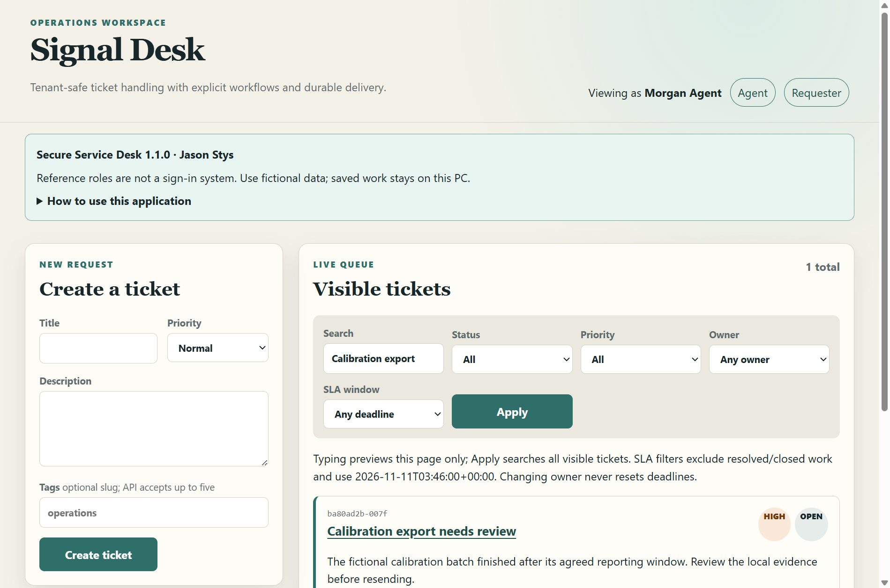
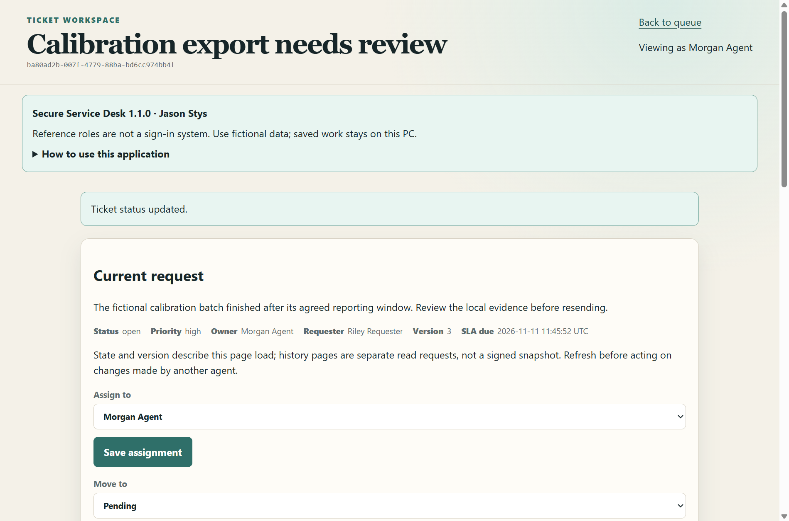

# Secure Service Desk native application

This Windows app runs the actual Laravel controllers, Blade forms, PHP ticket service and SQLite
database in a sandboxed Electron window. It is not an HTTP mock or a separate fixture-only demo.
Prepared records are normal inputs in the full application. Extract the whole portable package and
launch `SecureServiceDesk.exe`; preserve its resources directory. The user needs no development
runtime or commands. The unsigned folder is a portable application, not a signed OS installer.

## A practical complete ticket workflow

1. Read the local-workspace notice or open **Help > How this local workspace works**. The native
   title, icon, notice and source/contact menu identify Jason Stys and version 1.1.0.
2. Choose **Requester**, supply a title, description, priority and optional slug tags, then Create.
   The same real validators and request-key idempotence used by the API apply.
3. Choose **Agent** and open the ticket. Assign an eligible tenant agent, comment, and choose a legal
   lifecycle transition. Confirming applies it; canceling leaves state unchanged. Stale versions are
   rejected with a refresh message instead of silently overwriting a newer change.
4. Search or filter the queue by status/priority/owner/SLA window. A requester's access stays limited
   to their own requests. Another tenant cannot view a known foreign ticket. Discussion and audit
   pages are independent bounded windows; refreshing one is not a signed historical snapshot.
5. Exit through the menu/window, then relaunch. Your actual tickets, comments, versions and audit
   records persist. Prepared data is not reset at every startup. A complete initialization marker
   avoids reseeding completed work; interrupted first initialization can resume its idempotent seed.





## Identity, privacy and recovery

This remains a single OS-owner **reference-role** application. Choosing an actor demonstrates the
existing domain access rules; it is not a password login or authenticated multiuser boundary. Use
fictional records, not confidential customer data. Default development fixtures remain unchanged;
the native environment alone generates fresh inactive password hashes for reference actors. Those
passwords are not displayed or used as a desktop login.

The durable workspace is under the application's OS user-data directory, in its `workspace`
subdirectory, outside the executable and Git checkout. It contains a generated private application
key, SQLite database, local sessions/cache/views and an initialization marker. Data is plaintext
under that OS account's permissions; the same OS user/admin is trusted. A generated key encrypts
Laravel cookies, not the entire database. No private profile is packaged or committed. Back up the
entire profile only after clean exit; keep that backup private. Unknown nonempty profiles, invalid
identity/completion markers and unsafe or missing databases are refused. Failed SQLite bootstrap
preserves the database for recovery instead of running a destructive fresh reset. This is not
universal detection of logical database tampering.

One native instance owns the Electron profile. Each launch owns a literal `127.0.0.1` port-zero HTTP
listener and random private request header injected by the main process only for that exact origin.
Renderer Node integration is disabled, sandbox/context isolation stay enabled, outside requests,
popups, navigation and permissions are denied. A fixed source/contact menu is an explicit user
action opening the author's public profile; no private URL or token is sent.

The HTTP boundary checks Host, exact Origin, method, request/response byte budgets and concurrency
before fixed PHP CGI work. The URL cannot select a PHP script or command line; only the compiled-in
native entry point runs. PHP uses standalone ini flags, fixed argv and an allowlisted environment,
not developer `.env`, proxies, database URLs or provider credentials. Public assets are a narrow
compiled JS/CSS allowlist. Form navigation uses `Referrer-Policy: same-origin`: the Fetch standard
would serialize navigation POST Origin as `null` under `no-referrer`, which conflicts with exact
Origin checks and Laravel's same-origin return navigation. Outside referrers remain suppressed.

Requests are limited to 128 KiB, CGI output to 8 MiB, two active application requests and 180 private
requests/minute. Busy/limit responses are explicit. Child execution/output deadlines fail closed.
Client disconnect does not abandon an already started local transaction: the owned child is awaited.
Exit stops new work and drains actual owned requests before quitting; this is not a universal
shutdown deadline or a guarantee against OS crashes, forced process termination or disk failure.
SLA/outbox/HMAC APIs and CLI workers remain the original reference features; the desktop does not
automatically send email, webhooks or run a production scheduler. Notification intent remains local.

## Maintainer build and acceptance

The user-facing app bundles PHP 8.5.12 (official Windows 8.5.12-1 package), Electron 44.11.0 and only
locked production Composer dependencies. A signed app-local Microsoft CRT is copied from licensed
Visual Studio redistributables; no system runtime installer, PATH or registry changes are performed.
PHP and vendor license files, Electron/Chromium notices and source/hash metadata remain in the package.

On a Windows build machine with Node 24 and licensed Visual Studio redistributables:

```powershell
npm ci --ignore-scripts
pwsh -NoProfile -File scripts/prepare-native-sdk.ps1
$sdk = Get-Content .runtime/tooling/sdk.json -Raw | ConvertFrom-Json
$env:SSD_PHP_SDK = $sdk.php
$env:SSD_COMPOSER_PHAR = $sdk.composer
$env:SSD_CRT_SDK = $sdk.crt
$env:SSD_NATIVE_OUTPUT = 'release/my-candidate'
npm run build:native
pwsh -NoProfile -File scripts/archive-native.ps1 -Candidate release/my-candidate -Proof artifacts/native/my-new-proof
```

Use fresh output/staging/proof directories; earlier candidates/results are preserved. The SDK recipe
streams fixed official downloads under time/byte limits, verifies exact SHA256 before extraction,
and checks Microsoft CRT signatures. Composer has an isolated home, no account authentication,
no plugins/scripts, and production-only locked install. Build-only HTTPS is separate from runtime
CGI flags, which keep remote URL fopen and URL include disabled. The native acceptance strips developer runtimes from
PATH and uses only an explicitly marked synthetic profile selected before Electron initializes.
Actual forms/CSRF/roles/versions and two independent native launches are tested, not mocked responses.
The archive command creates a complete ZIP and SHA256 sidecar, extracts that fresh archive and runs
the relocated executable. Acceptance compares source identity and both bundled launcher-module
hashes with the build record and the current checkout. Those hashes are observed from the launched
application's own ASAR; they do not authenticate an installation against a malicious OS owner.

Native CI has read-only source permissions and never publishes. It retains bounded synthetic proof
for one day; complete unsigned packages require an explicit trusted-main manual retention request.
PHP semantic CodeQL is not supported: the existing CodeQL job covers JavaScript, now including the
native Node boundary. PHP validation is separate formatter/test/Composer audit/PostgreSQL/browser
evidence. Current source checks do not retroactively certify historical Word publications.

## New file responsibilities

| File | Responsibility |
| --- | --- |
| `desktop/main.mjs` | Sandbox, exact-origin header injection, first-use status/help, single instance and retained shutdown. |
| `desktop/runtime.mjs` | Durable profile/key, real PHP version probe, fixed CGI gateway, strict HTTP/file limits and drain. |
| `native/bootstrap.php` | Isolated Laravel environment/storage/configuration assertions without developer config. |
| `native/console.php` | Actual migration/seed entry, without destructive `migrate:fresh`. |
| `native/public.php` | Actual Laravel Request handling through a fixed CGI script. |
| `resources/views/native-notice.blade.php` | Native-only local-role/privacy help and product attribution. |
| `.env.testing` | Public synthetic in-memory test settings, so local core tests need not load development secrets. |
| `tests/Feature/NativeSeedTest.php` | Random native inactive credentials and repeated seed preserving existing rows. |
| `tests/native/runtime.test.mjs` | Real bounded/hardlink file cases and independent malformed CGI/argv cases. |
| `scripts/prepare-native-sdk.ps1` | Official checksum-bound build SDK download and signed CRT selection. |
| `scripts/build-native.mjs` | Production-only source/dependency packaging, authored icon and immutable candidate metadata. |
| `scripts/archive-native.ps1` | Fresh complete ZIP, streaming SHA256, relocation and real extracted-app acceptance. |
| `scripts/test-native-app.mjs` | Actual packaged role/CSRF/version/search/persistence/exit acceptance and bounded diagnostics. |
| `.github/workflows/native-app.yml` | Real Windows package tests with bounded routine artifact retention. |

Exact function/variable line locations are in [the generated code index](code-index.md).

Primary references: [PHP Windows installation](https://www.php.net/manual/en/install.windows.php),
[PHP CGI security](https://www.php.net/manual/en/security.cgi-bin.php),
[Fetch Origin header algorithm](https://fetch.spec.whatwg.org/#append-a-request-origin-header),
[Electron security](https://www.electronjs.org/docs/latest/tutorial/security), and
[Microsoft runtime redistribution](https://learn.microsoft.com/en-us/cpp/windows/redistributing-visual-cpp-files).
